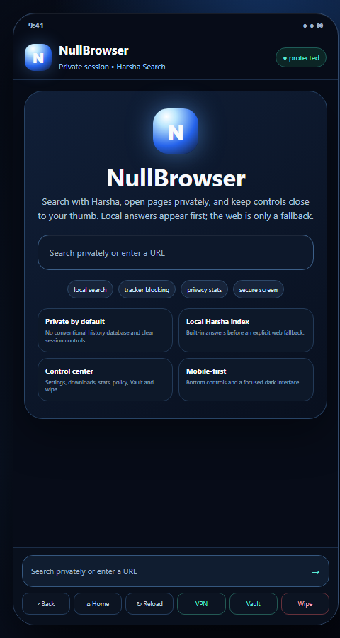
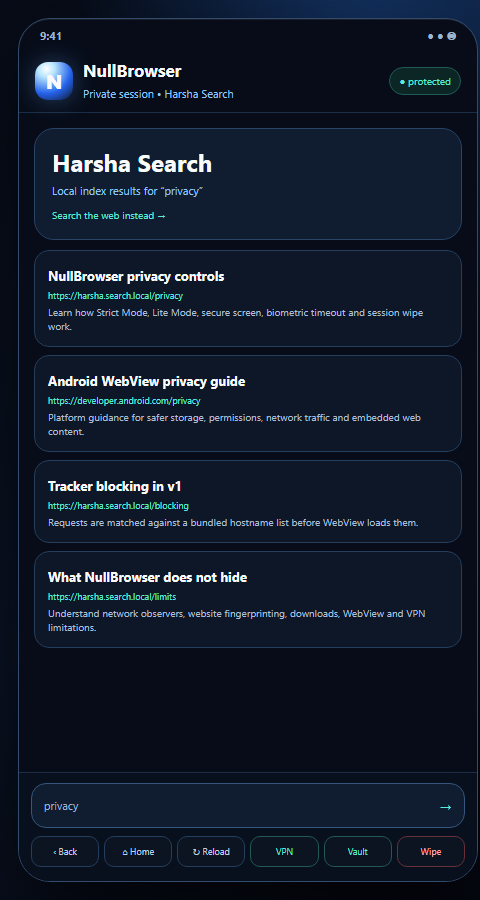
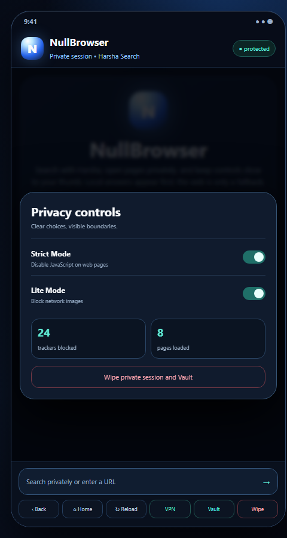
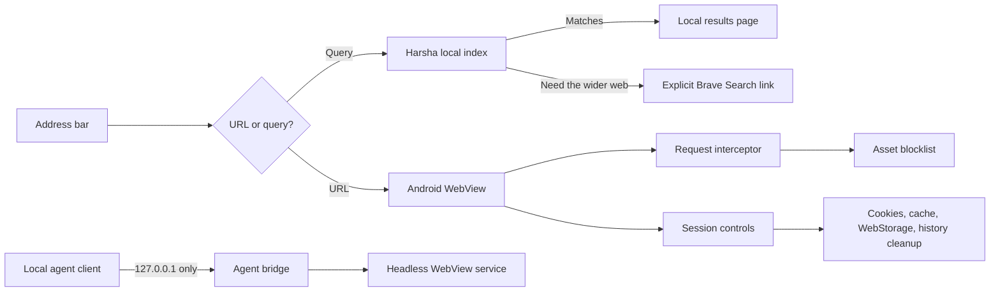

<div align="center">

# NullBrowser

### A small, privacy-minded Android browser built to be understood, extended, and owned by its community.

[](https://github.com/Adithiyaaaaaaa/nullbrowser-/actions/workflows/android.yml)
[](https://github.com/Adithiyaaaaaaa/nullbrowser-/releases)
[](LICENSE)
[](#requirements)

**Private browsing · Local-first search · Tracker blocking · Session controls · Automation experiments**

[Download v1](https://github.com/Adithiyaaaaaaa/nullbrowser-/releases/latest) · [Quick start](#quick-start) · [Architecture](docs/ARCHITECTURE.md) · [Contribute](CONTRIBUTING.md)

</div>

> [!IMPORTANT]
> NullBrowser v1 is an experimental community release, not an audited anonymity product. It uses Android WebView, the VPN is a tunnel scaffold without a relay backend, and the anti-fingerprinting layer is best-effort. Read the [privacy and security model](docs/SECURITY.md) before relying on it for sensitive activity.

## Why NullBrowser?

Most browsers hide their privacy behavior behind a large stack. NullBrowser takes the opposite approach: it is a compact native Android project where the browser shell, search flow, blocking rules, local storage, cleanup controls, and automation surface are easy to inspect.

It is useful for:

- people who want a minimal browser that does not keep a conventional history database;
- Android developers learning WebView hardening, request interception, Room, biometrics, or `VpnService`;
- privacy researchers prototyping blocklists, fingerprint defenses, and session-lifecycle ideas;
- builders experimenting with a loopback-only browser automation API;
- contributors who want a focused codebase instead of a full Chromium fork.

## v1 at a glance

| Module | What it does | v1 status |
| --- | --- | --- |
| Browser shell | Native Kotlin UI, bottom controls, address/search input, downloads, page info | Working |
| Harsha Search | Scores a bundled TSV index locally, then offers Brave Search as an explicit web fallback | Working, small index |
| Tracker blocker | Intercepts requests and matches tracker hosts from an asset-backed domain list | Working, list-based |
| Privacy modes | Strict Mode disables JavaScript; Lite Mode blocks page images | Working |
| Session protection | Secure-screen flag, manual panic wipe, session cleanup, 10-day inactivity wipe | Working |
| Biometric lock | Re-authenticates after a 30-second background timeout; repeated failures wipe local state | Working on supported devices |
| NullVault | Room-backed bookmark storage with add, open, and clear actions | Working; local database is not encrypted in v1 |
| Headless engine | Service-backed WebView navigation, JavaScript evaluation, click, and Markdown extraction | Experimental |
| Local agent bridge | Loopback-only HTTP bridge on `127.0.0.1:8080` | Experimental; unauthenticated in v1 |
| Privacy VPN | Establishes an Android TUN interface for the app | Scaffold only; no traffic-forwarding backend |
| Native signature helper | JNI proof of concept for signature/key checks | Scaffold only; not wired as a trust boundary |

## Interface preview

Fresh v1 previews are generated from the current app interface for this release; the older repository mockups are not used here.

<p align="center">
  
  
  
</p>

> Production builds set `FLAG_SECURE`, so Android intentionally blocks ordinary device screenshots and screen recordings. The preview assets are documentation renders of the v1 UI, not captures of a user's browsing session.

## How it works



### Browsing flow

1. Enter a URL or query in the bottom address bar.
2. URLs load in Android WebView; plain text opens the local Harsha Search route.
3. Requests are checked against `assets/blocklists/trackers.txt` before loading.
4. Strict Mode can disable JavaScript and Lite Mode can suppress images.
5. Use **Wipe** at any time to clear cookies, cache, form data, WebStorage, WebView history, preferences, and vault entries.

### Harsha Search

The bundled index is deliberately small and readable:

```text
app/src/main/assets/search/harsha_index.tsv
```

`HarshaIndex.kt` tokenizes the query and scores title, keywords, snippet, and URL. Up to six local results are rendered inside the app. A separate link opens Brave Search when the local index is not enough; queries are not silently sent to the web.

To add an entry, append a tab-separated line:

```text
Title<TAB>https://example.com<TAB>Short description<TAB>keyword one keyword two
```

### Tracker blocking

`AdBlockerEngine.kt` loads tracker domains on a background executor. It checks exact hosts and parent domains during WebView request interception. Add one lowercase hostname per line to:

```text
app/src/main/assets/blocklists/trackers.txt
```

This is domain blocking, not a full cosmetic ad blocker. It does not parse EasyList rules or remove empty page elements.

### Privacy controls

- **Secure screen:** release UI uses `FLAG_SECURE` to discourage screenshots and recording.
- **Panic wipe:** clears app-side browsing state and bookmarks immediately.
- **Inactivity wipe:** clears private state after ten days without activity.
- **Strict Mode:** disables JavaScript for a smaller attack and tracking surface.
- **Lite Mode:** blocks network images for speed and lower data usage.
- **Root/debug signals:** warns on common root indicators and wipes if a debugger is attached.
- **Biometric timeout:** requests strong biometric authentication after the app has remained in the background for 30 seconds.

## Quick start

### Requirements

- Android Studio with Android SDK 35
- JDK 17 or newer supported by the selected Android Gradle Plugin
- Android 8.0 / API 26 or newer device or emulator
- PowerShell on Windows for the helper script

### Build the debug APK

```powershell
git clone https://github.com/Adithiyaaaaaaa/nullbrowser-.git
cd nullbrowser-
./build-apk.ps1
```

Output:

```text
app/build/outputs/apk/debug/app-debug.apk
```

Install on a connected device:

```powershell
./build-apk.ps1 installDebug
```

Or open the repository in Android Studio, allow Gradle sync to finish, select the `app` configuration, and press **Run**.

### First five minutes

1. Launch NullBrowser and try a built-in query such as `privacy` or `android`.
2. Open the overflow menu to inspect Privacy Stats, downloads, policy, and page info.
3. Toggle Strict Mode and Lite Mode from Settings, then reload a page.
4. Add the current page to Vault and reopen it from the Vault button.
5. Use Wipe and confirm that the session and local bookmarks are cleared.

## Automation API (experimental)

When the activity binds the headless service, v1 starts a server bound to `127.0.0.1:8080`. It is not reachable from other network devices, but it has no authentication. Treat it as a local developer surface, not a hardened production API.

```bash
# Navigate the headless WebView
curl "http://127.0.0.1:8080/goto?url=https%3A%2F%2Fexample.com"

# Extract the current page as Markdown-like text
curl "http://127.0.0.1:8080/extract_markdown"

# Click an element
curl "http://127.0.0.1:8080/click?selector=%23more-info"

# Evaluate JavaScript; URL-encode the script value
curl "http://127.0.0.1:8080/evaluate?script=document.title"
```

Android apps and desktop tools may need `adb forward tcp:8080 tcp:8080` to reach the device loopback service during development.

## Project map

```text
app/src/main/
├── java/com/nullbrowser/privacy/
│   ├── MainActivity.kt               browser UI, WebView policy, menus, wipes
│   ├── NullSearch.kt                 home and local-results HTML
│   ├── HarshaIndex.kt                local TSV loader and ranker
│   ├── AdBlockerEngine.kt            tracker matching and JS defenses
│   ├── BiometricLock.kt              background lock and failure wipe
│   ├── NullVault.kt                  Room bookmark database
│   ├── PrivacyVpnService.java        TUN-interface scaffold
│   ├── HeadlessAutomationService.kt  off-screen WebView actions
│   ├── LocalAgentServer.kt           loopback HTTP bridge
│   ├── RootSignals.kt                basic rooted-device signals
│   └── NativeLib.kt                  JNI interface proof of concept
├── assets/
│   ├── blocklists/trackers.txt
│   └── search/harsha_index.tsv
└── cpp/
    └── native-lib.cpp
```

For component boundaries and request flows, see [Architecture](docs/ARCHITECTURE.md). For threat boundaries and limitations, see [Security & privacy](docs/SECURITY.md).

## Roadmap

- [ ] Make the local agent server opt-in and add per-session authentication
- [ ] Add unit tests for Harsha ranking and domain matching
- [ ] Add instrumented tests for wipe, modes, and navigation flows
- [ ] Replace the VPN scaffold with a reviewed forwarding implementation and provider configuration
- [ ] Encrypt or remove persistent Vault storage based on a documented threat model
- [ ] Add per-site permissions and clearer WebView data controls
- [ ] Expand the local index through a reproducible data pipeline
- [ ] Add signed release builds and reproducible checksums
- [ ] Complete accessibility and localization passes

## Community

NullBrowser v1 is the start of a community project. Small pull requests are welcome: blocklist additions, local-index entries, tests, accessibility fixes, documentation, and narrowly scoped privacy improvements are all good first contributions.

- Read [CONTRIBUTING.md](CONTRIBUTING.md) before opening a pull request.
- Use the issue templates for bugs and feature proposals.
- Report security-sensitive problems privately as described in [SECURITY.md](SECURITY.md).
- Follow the [Code of Conduct](CODE_OF_CONDUCT.md).

## Release status

The `v1.0.0` community release establishes the public baseline: a buildable Android app, documented module boundaries, honest privacy limits, contributor templates, CI, and release notes. See [CHANGELOG.md](CHANGELOG.md) for the release history.

## License

NullBrowser is free software licensed under the [GNU General Public License v2.0](LICENSE). If you distribute modified binaries, review the license obligations and provide the corresponding source as required.

---

<div align="center">

Built in public. Privacy claims should be testable, limitations should be visible, and contributions should be reviewable.

</div>
