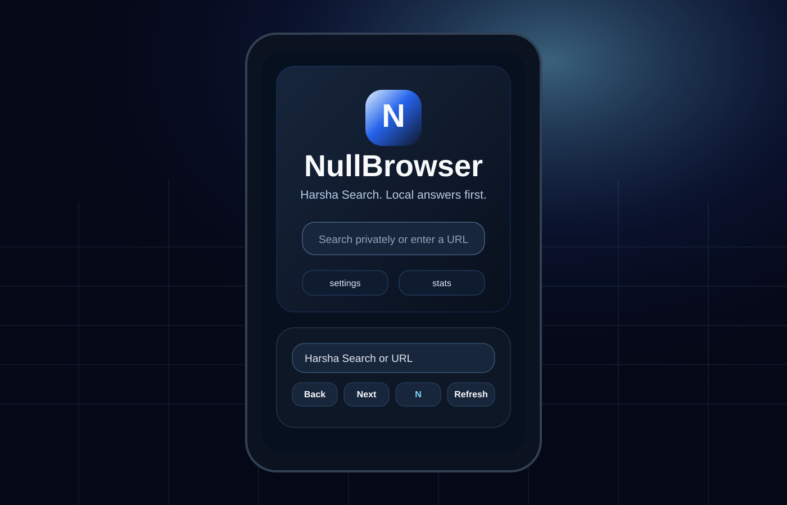
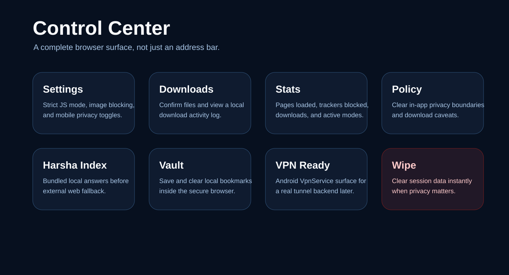
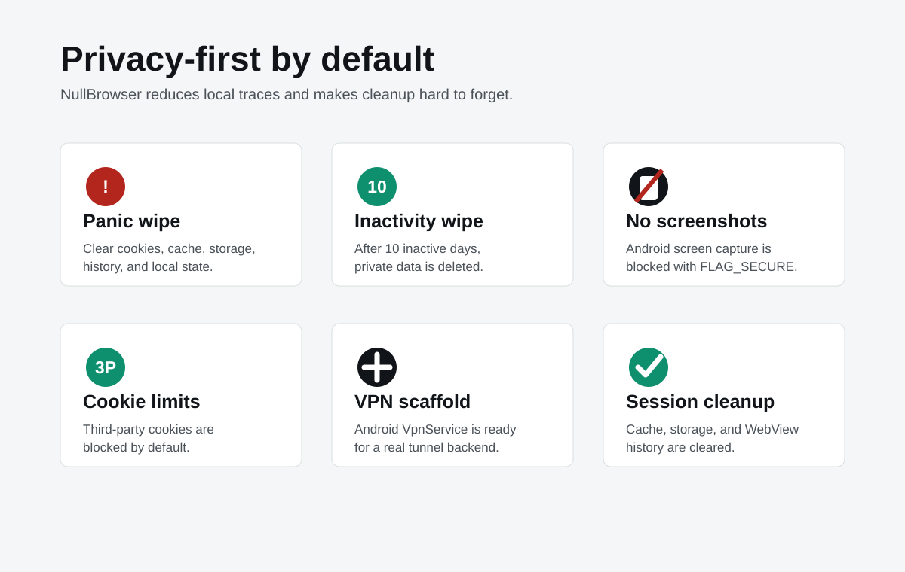

# NullBrowser

NullBrowser is a privacy-first Android browser prototype with a polished mobile UI, a local Harsha Search index, bottom-mounted controls, and built-in privacy tools. It is built as a native Android project using Kotlin, Android WebView, Room, biometric locking, and a small asset-backed search/blocklist layer.

The goal is not to pretend this is already Google-scale search or a Chromium replacement. The useful version is sharper: a small, private browser that feels good on a phone, explains its privacy boundaries clearly, and has a real foundation for growing Harsha Search into a dedicated backend later.

## Screens

Real device screenshots are blocked by `FLAG_SECURE`, which is one of the privacy protections. The repo uses designed mockups instead.







## Current Features

- **N-branded launcher icon:** The app icon is now a clean `N` mark.
- **Mobile-first UI:** Bottom address bar and thumb-friendly controls.
- **Harsha Search:** Local instant-answer index bundled inside the APK.
- **Web fallback:** Unknown searches fall back to a working external web provider.
- **Control Center:** Settings, downloads, privacy policy, page info, and clear-session actions.
- **Privacy Stats:** Pages loaded, trackers blocked, downloads started, and active privacy modes.
- **Download Manager:** Confirms downloads and hands them to Android Download Manager.
- **Tracker Blocking:** Asset-backed tracker domain dataset.
- **Secure Screen:** Screenshots and screen recording blocked through `FLAG_SECURE`.
- **Session Cleanup:** Cookies, cache, form data, WebView history, and WebStorage cleanup.
- **10-Day Inactivity Wipe:** Clears private state after 10 inactive days.
- **Biometric Lock:** Background timeout protection with panic wipe behavior.
- **Vault:** Local bookmark storage using Room.
- **VPN Surface:** Android `VpnService` scaffold ready for a real tunnel/provider.
- **Headless Automation Service:** Local automation surface for AI/browser agent experiments.

## Harsha Search

Harsha Search has two layers:

1. **Local index:** The app ships with a small TSV dataset for instant answers:

```text
app/src/main/assets/search/harsha_index.tsv
```

2. **Web fallback:** If the local index has no result, the browser routes to a working web search provider.

The local scorer lives here:

```text
app/src/main/java/com/nullbrowser/privacy/HarshaIndex.kt
```

This is genuinely more than a shell, but it is not a full internet-scale search engine yet. A real independent search engine would need a crawler, document index, ranking pipeline, storage, abuse controls, and hosted backend APIs.

## Privacy Model

NullBrowser is designed to minimize app-side traces.

- It does not maintain a normal browsing history database.
- It clears WebView session state on app destruction and panic wipe.
- It blocks screenshots and screen recordings.
- It blocks known tracker domains from an asset dataset.
- It exposes Strict Mode to disable JavaScript.
- It exposes Lite Mode to block page images.
- It records only small local counters for stats unless reset/wiped.

Important limits:

- Android WebView is still the rendering engine.
- Downloads saved to Android Downloads can remain outside the app.
- A real VPN still requires a provider/server/tunnel backend.
- Website fingerprinting cannot be fully solved by JavaScript spoofing alone.

## Architecture

```text
app/src/main/java/com/nullbrowser/privacy/
  MainActivity.kt              Human browser UI, WebView, settings, downloads, stats
  NullSearch.kt                Harsha Search home/results HTML generator
  HarshaIndex.kt               Bundled local search index loader and scorer
  AdBlockerEngine.kt           Asset-backed tracker domain blocking
  BiometricLock.kt             Biometric/session lock and wipe callback
  NullVault.kt                 Room bookmark vault
  PrivacyVpnService.java       Android VpnService scaffold
  HeadlessAutomationService.kt Headless browser automation experiment
  LocalAgentServer.kt          Local agent server bridge
```

Assets:

```text
app/src/main/assets/search/harsha_index.tsv
app/src/main/assets/blocklists/trackers.txt
```

Images:

```text
docs/images/browser-ui-mockup.svg
docs/images/control-center.svg
docs/images/privacy-features.svg
```

## Build

From the project root:

```powershell
powershell -ExecutionPolicy Bypass -File .\build-apk.ps1
```

APK output:

```text
app/build/outputs/apk/debug/app-debug.apk
```

Install on a connected Android device:

```powershell
powershell -ExecutionPolicy Bypass -File .\build-apk.ps1 installDebug
```

## Android Studio

1. Open this folder in Android Studio.
2. Let Gradle sync.
3. Connect your phone or start an emulator.
4. Run the `app` configuration.

## Roadmap

- Replace the web fallback with a dedicated Harsha Search backend.
- Add a larger generated index pipeline for local docs and trusted sources.
- Improve Control Center into a full native settings screen.
- Add per-site permissions.
- Add a real VPN tunnel implementation.
- Add release signing and a proper release channel.
- Add UI tests for mobile layouts.
- Add unit tests for Harsha index scoring and blocklist matching.

## License

No license has been selected yet. Add one before public release.
